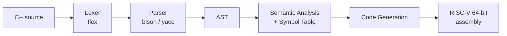

> 這是我在台大資訊工程系「編譯程式設計」（CSIE3230，114-1，洪鼎詠教授）的期末專案：一個會產生 RISC-V 64 位元組合語言的 C-- 編譯器，與一位同學合作完成。本頁整理設計說明、我的分工與測試成果；完整原始碼在 [`stages/`](stages) 底下，依四個階段（lexer／parser／語意分析／程式碼產生）分別存放。

# C-- Compiler — RISC-V Code Generator

A from-scratch compiler for **C--** (a small, carefully restricted subset of ANSI C) that compiles down to **RISC-V 64-bit assembly**, runnable under QEMU. Built as the four-part final project for the *Compiler Design* course (CSIE3230) at National Taiwan University, Fall 2025 (114-1), taught by Prof. Ding-Yong Hong.

**Team of 2.** Built incrementally across four milestones, each adding one stage of the pipeline.

> **Source layout**: the full implementation lives under [`stages/`](stages), split into the four graded milestones (lexer → parser → semantic analysis → code generation). `stages/hw4-codegen/` is the final, complete compiler; each earlier stage folder is a snapshot of the project as it stood at that milestone, not a separate standalone program. Teammate contributions are included as committed, but my teammate is referred to only as "my teammate" throughout — not by name — since this repository was published under my own account without a separate attribution pass on their behalf.

## Pipeline



Each stage was a separate graded milestone, built on top of the previous one:

| Stage | Milestone | What it does |
|---|---|---|
| 1 | Lexer | Tokenizes C-- source using hand-written regular expressions in flex |
| 2 | Parser | Builds an abstract syntax tree (AST) from the token stream using a bison grammar |
| 3 | Semantic Analysis | Type-checks the AST and manages scoping via a hash-table-based symbol table |
| 4 | Code Generation | Walks the AST and emits RISC-V 64-bit assembly directly (no intermediate representation) |

No classic optimization pass (constant folding, dead-code elimination, peephole) was in scope for this course — the project targets a correct, directly-generated backend.

## Supported Language Features

| Category | Supported |
|---|---|
| Primitive types | `int`, `float` |
| Composite types | Multi-dimensional arrays |
| Control flow | `if` / `else`, `for`, `while` |
| Functions | Definitions, calls, **recursion** |
| Scoping | Global and nested block scope, including variable shadowing |
| Type aliasing | `typedef` |
| I/O | `read()`, `fread()`, `write()` (library calls, type-dispatched at compile time) |
| Not supported (out of course scope) | `struct`/`union`, pointer arithmetic, array initializers, `do-while`/`switch`/`break`/`continue`/`goto` |

## Design Highlights

- **Direct AST-to-assembly codegen.** There is no separate IR; each AST node is walked once and emits RISC-V instructions directly.
- **Stack-based calling convention.** All function arguments are passed on the stack rather than in `a0`–`a7`, which simplified handling functions with more than 8 arguments (see the 10-argument test below) at the cost of more verbose generated code than a register-passing ABI would produce.
- **Explicit stack frame layout.** Each function's frame size is computed at compile time and stored as a data-section constant, loaded at runtime to grow the stack — a trade-off that avoids a separate "frame size backpatch" pass at the cost of one extra memory load per call.
- **Round-robin register allocation.** Registers are allocated in rotation rather than via liveness analysis or graph coloring — correct but not optimal; a known limitation, and the natural next step if this project were extended.

## My Role & Contributions

This was a 2-person team project. My teammate was primarily responsible for the lexer, parser/grammar, the bulk of semantic analysis and the symbol table, and the core register-allocation and expression/control-flow code generation. **My own, individually-authored contributions**, verifiable by commit history:

- **Global variable handling in codegen**: translating global scalar, float, and array declarations (including initializers) into the correct data-section directives, and fixing a bug where global symbols weren't being registered in the symbol table. (`stages/hw4-codegen/codegen.c`, `visitGlobalDecl` / `visitGlobalDeclList`)
- **String constant handling**: collecting string literals used in `write()` calls and emitting them as a dedicated read-only data section with generated labels. (`stages/hw4-codegen/codegen.c`, `gen_str_const_section`)
- **Function prologue/epilogue generation**: the entry/exit code for every function, including the scheme for computing and loading each function's stack frame size at runtime. (`stages/hw4-codegen/codegen.c`, `gen_prologue` / `gen_epilogue`)
- **Multi-dimensional array indexing**: rewrote the subscript address calculation (accumulating byte offsets stride-by-stride across dimensions) after finding and fixing a bug where the wrong AST node was being passed into the subscript calculator. (`stages/hw4-codegen/codegen.c`, `emit_array_subscript`)
- **Test design — parser-level grammar failures**: wrote all three dedicated "should fail to parse" test cases for array declarations (`stages/hw3-semantic/tests/pfail1.c`–`pfail3.c`), each isolating a *different* reason an array declaration is invalid: a non-integer dimension literal (`int c[2.5]`), a non-constant dimension expression (`int b[a]`, where `a` is a variable rather than something the grammar's constant-expression rule can reduce), and an empty dimension used outside a function parameter list (`int a[]`). I also split an earlier bundled test that mixed the first two failure modes into one file into two separate ones, since they exercise different paths through the grammar — conflating them would hide which rule actually broke if only one of them failed.
- **Test design — code generation**: authored 5 of the final-stage test programs (`stages/hw4-codegen/tests/`) and the semantic-analysis regression runner from an earlier milestone (`stages/hw3-semantic/run.sh`). These weren't thrown together — each one was picked to isolate a specific feature (10-argument stack passing, 2D array indexing in both row- and column-major traversal order, variable shadowing across nested scopes, float arithmetic with a global constant, in-place array sorting), because I wanted the test suite to actually catch the kind of bugs this backend was likely to have, not just exercise the happy path.

## Testing & Results

- Across the project's semantic-analysis and code-generation milestones, I authored regression tests spanning both valid programs and deliberately invalid ones (syntax errors, type errors, scope errors).
- **Final grade: A+.** Worth noting honestly: grading in this course was generous — most of the class also received A+, so this reflects meeting the bar rather than standing out from it.
- **Re-verified for this write-up**: I rebuilt the final compiler from source in a clean environment and re-ran it against one of my own test programs (below). It compiled without errors or warnings and produced structurally correct RISC-V assembly — the comparison and branch for the test's `if`/`else` check lower exactly as expected. I did not have a RISC-V toolchain + QEMU available in this environment to execute the resulting binary, so the *runtime* output below reflects the program's expected behavior per its own logic, not a freshly-executed run. (The implementation was executed and verified during the original course submission, which produced the A+ grade above.)

## Example

Input — a self-contained test I wrote to check that the backend correctly handles a function call with more arguments than fit in the RISC-V calling convention's register file:

```c
int sum_many(int a, int b, int c, int d, int e, int f, int g, int h, int i, int j) {
    return a+b+c+d+e+f+g+h+i+j;
}

int main() {
    int x = sum_many(1, 1, 1, 1, 1, 1, 1, 1, 10, 20);
    if (x == 38) {
        write("PASS");
    } else {
        write("FAIL");
    }
}
```

Excerpt of the generated assembly (the lowering of the `if (x == 38)` check — re-generated by rebuilding the compiler for this write-up):

```asm
lw   x17, -336(x8)
li   x18, 38
sub  x18, x17, x18
seqz x18, x18
beqz x18, _else_start_0
...
jal  write_str          ; true branch: write("PASS")
```

Expected output: `PASS`

Full file: [`stages/hw4-codegen/tests/sum_many.c`](stages/hw4-codegen/tests/sum_many.c)

## Build & Run

Each stage folder has its own `Makefile`. To build the final compiler (`stages/hw4-codegen/`):

```sh
cd stages/hw4-codegen
make                       # requires flex, bison, gcc — produces ./compiler
./compiler < tests/sum_many.c   # writes RISC-V assembly to output.s
```

Running the generated assembly end-to-end additionally requires a RISC-V 64-bit cross compiler (`riscv64-unknown-elf-gcc`) and `qemu-riscv64-static`, per the course's toolchain instructions — build `utils/` first to get the `main()` wrapper that calls into the generated code, then assemble `output.s` with it and run under QEMU.

## Notes

- Course: Compiler Design (CSIE3230), National Taiwan University, Fall 2025 (114-1), Prof. Ding-Yong Hong. Project specification ("C-- Language") and milestone assignments were provided by the instructor.
- **AI/LLM usage**: essentially none during the original implementation. (This write-up itself was drafted with AI assistance from the author's notes and the project's commit history — the compiler code was not.)
